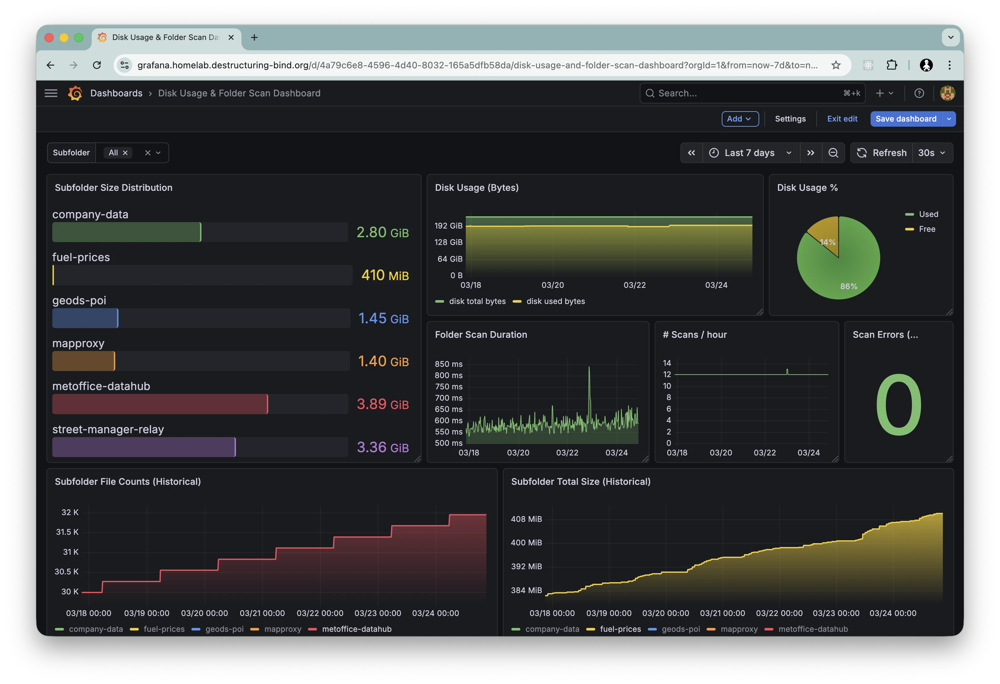

# du-exporter

## Overview

`du-exporter` is a Go program designed to mimic the functionality of the Unix `du` command, specifically for exporting Prometheus metrics related to subfolder disk usage. It scans one or more root directories and their subfolders, collecting metrics such as:

-   **Subfolder Metrics:** File count, total size, and newest/oldest modification times for top-level subfolders.
-   **Folder Metrics:** File count, total size, and modification times for folders at any depth, with recursive aggregation.
-   **Folder Size:** Size of individual folders at any depth, labeled by folder path, parent path, and depth.
-   **File Metrics:** Size of individual files matching configured glob patterns.
-   **Disk Usage:** Total, used, and free space (in bytes and percentage) on the filesystem of each root path.
-   **Scan Metrics:** Scan duration, total scans, and error count.

These metrics are exposed via an HTTP server, making them easily consumable by Prometheus. The application uses `cobra` for command-line argument parsing.

### Grafana Dashboard

A sample Grafana [dashboard.json](./dashboard.json) is available:



## Technologies

- **Language:** Go (version 1.27)
- **Metrics:** Prometheus client library (`github.com/prometheus/client_golang`)
- **CLI:** Cobra (`github.com/spf13/cobra`)
- **Containerization:** Docker
- **CI/CD:** GitHub Actions

## Building and Running

### Prerequisites

- Go (version 1.27 or later)
- Docker (optional, for containerized deployment)

### Build

To build the executable:

```bash
go build -ldflags="-w -s" -o du-exporter .
```

### Run (CLI)

The application can be run directly from the command line:

```bash
./du-exporter --root <path_to_watch> --interval <scan_interval_seconds> --port <server_port>
```

**Example:**

```bash
./du-exporter --root ./watched --interval 60 --port 8080
```

**Example with multiple roots, depth limiting, and exclusions:**

```bash
./du-exporter --root /data --root /backup --interval 60 --limit-depth 3 --exclude temp --exclude backups
```

-   `--root`: Specifies the root folder(s) to watch (repeatable, default: `./watched`).
-   `--interval`: Sets the scan interval in seconds (default: `300`).
-   `--port`: Sets the port for the HTTP server (default: `8080`).
-   `--glob`: File glob patterns to include for individual file metrics (repeatable, default: `**/*.db`).
-   `--limit-depth`: Maximum folder depth for metrics (1 = top-level subfolders only, default: `1`).
-   `--exclude`: Subdirectory names to skip during scanning (repeatable, default: none).

The application will expose metrics at `http://localhost:<port>/metrics` and a health check endpoint at `http://localhost:<port>/healthz`.

### Metrics

All metrics are prefixed with `du_`. They fall into five groups:

**Subfolder metrics** (labeled by `root`, `folder`): Top-level subfolder statistics.

| Metric | Type | Description |
|---|---|---|
| `du_subfolder_file_count` | Gauge | Number of files in a subfolder |
| `du_subfolder_total_size_bytes` | Gauge | Total size of files in a subfolder (bytes) |
| `du_subfolder_newest_mtime_seconds` | Gauge | Newest file modification time (epoch seconds) |
| `du_subfolder_oldest_mtime_seconds` | Gauge | Oldest file modification time (epoch seconds) |

**Folder metrics** (labeled by `root`, `folder`, `depth`): Recursive folder statistics at any depth.

| Metric | Type | Description |
|---|---|---|
| `du_folder_file_count` | Gauge | Number of files in a folder at a given depth (recursive) |
| `du_folder_total_size_bytes` | Gauge | Total size of files in a folder at a given depth (bytes, recursive) |
| `du_folder_newest_mtime_seconds` | Gauge | Newest file modification time at a given depth (epoch seconds, recursive) |
| `du_folder_oldest_mtime_seconds` | Gauge | Oldest file modification time at a given depth (epoch seconds, recursive) |

**Folder size metric** (labeled by `folder`, `parent_path`, `depth`): Individual folder size.

| Metric | Type | Description |
|---|---|---|
| `du_folder_size_bytes` | Gauge | Size of a folder at a given depth (bytes, recursive) |

**File metrics** (labeled by `path`): Individual file sizes matching glob patterns.

| Metric | Type | Description |
|---|---|---|
| `du_file_size_bytes` | Gauge | Size of files matching configured globs (bytes) |

**Disk metrics** (labeled by `path`): Filesystem statistics.

| Metric | Type | Description |
|---|---|---|
| `du_disk_total_bytes` | Gauge | Total bytes on the filesystem |
| `du_disk_used_bytes` | Gauge | Used bytes on the filesystem |
| `du_disk_free_percent` | Gauge | Percentage of free space |
| `du_disk_used_percent` | Gauge | Percentage of used space |

**Scan metrics** (no labels): Operational statistics.

| Metric | Type | Description |
|---|---|---|
| `du_scan_duration_seconds` | Histogram | Duration of each folder scan |
| `du_scan_total` | Counter | Total number of scans performed |
| `du_scan_errors_total` | Counter | Total number of scan errors |

For example, the metrics show as follows (standard go metrics removed for brevity):

```prometheus
# HELP du_disk_free_percent Percentage of free space on the filesystem of a path
# TYPE du_disk_free_percent gauge
du_disk_free_percent{path="../map-services/data"} 24.00718717662695
# HELP du_disk_total_bytes Total bytes on the filesystem of a path
# TYPE du_disk_total_bytes gauge
du_disk_total_bytes{path="../map-services/data"} 4.94384795648e+11
# HELP du_disk_used_bytes Used bytes on the filesystem of a path
# TYPE du_disk_used_bytes gauge
du_disk_used_bytes{path="../map-services/data"} 3.75696912384e+11
# HELP du_scan_duration_seconds Duration of the folder scan in seconds
# TYPE du_scan_duration_seconds histogram
du_scan_duration_seconds_bucket{le="0.005"} 0
du_scan_duration_seconds_bucket{le="0.01"} 0
du_scan_duration_seconds_bucket{le="0.025"} 0
du_scan_duration_seconds_bucket{le="0.05"} 4
du_scan_duration_seconds_bucket{le="0.1"} 8
du_scan_duration_seconds_bucket{le="0.25"} 9
du_scan_duration_seconds_bucket{le="0.5"} 9
du_scan_duration_seconds_bucket{le="1"} 9
du_scan_duration_seconds_bucket{le="2.5"} 9
du_scan_duration_seconds_bucket{le="5"} 9
du_scan_duration_seconds_bucket{le="10"} 9
du_scan_duration_seconds_bucket{le="+Inf"} 9
du_scan_duration_seconds_sum 0.6477451670000001
du_scan_duration_seconds_count 9
# HELP du_scan_errors_total Total number of folder scan errors
# TYPE du_scan_errors_total counter
du_scan_errors_total 0
# HELP du_scan_total Total number of folder scans performed
# TYPE du_scan_total counter
du_scan_total 9
# HELP du_subfolder_file_count Number of files in a subfolder
# TYPE du_subfolder_file_count gauge
du_subfolder_file_count{folder="company-data",root="../map-services/data"} 1
du_subfolder_file_count{folder="mapproxy",root="../map-services/data"} 11368
# HELP du_subfolder_newest_mtime_seconds Modification time of the newest file in a subfolder (epoch seconds)
# TYPE du_subfolder_newest_mtime_seconds gauge
du_subfolder_newest_mtime_seconds{folder="mapproxy",root="../map-services/data"} 1.758487709e+09
# HELP du_subfolder_oldest_mtime_seconds Modification time of the oldest file in a subfolder (epoch seconds)
# TYPE du_subfolder_oldest_mtime_seconds gauge
du_subfolder_oldest_mtime_seconds{folder="mapproxy",root="../map-services/data"} 1.756578834e+09
# HELP du_subfolder_total_size_bytes Total size of files in a subfolder (bytes)
# TYPE du_subfolder_total_size_bytes gauge
du_subfolder_total_size_bytes{folder="mapproxy",root="../map-services/data"} 2.53604661e+08
# HELP du_folder_file_count Number of files in a folder at a given depth (recursive)
# TYPE du_folder_file_count gauge
du_folder_file_count{depth="1",folder="mapproxy",root="../map-services/data"} 11368
du_folder_file_count{depth="2",folder="mapproxy/cache",root="../map-services/data"} 5432
# HELP du_folder_size_bytes Size of a folder at a given depth (bytes, recursive)
# TYPE du_folder_size_bytes gauge
du_folder_size_bytes{depth="1",folder="mapproxy",parent_path="../map-services/data"} 2.53604661e+08
du_folder_size_bytes{depth="2",folder="mapproxy/cache",parent_path="../map-services/data"} 1.20458321e+08
# HELP du_file_size_bytes Size of files matching configured globs (bytes)
# TYPE du_file_size_bytes gauge
du_file_size_bytes{path="../map-services/data/mapproxy/database.db"} 104857600
```

### Run (Docker)

A Docker image can be built and run. The official image is published to `ghcr.io/rm-hull/du-exporter`.

**Build Docker Image:**

```bash
docker build -t du-exporter .
```

**Run Docker Container:**

```bash
docker run -p 8080:8080 -v /path/to/your/data:/data du-exporter --root /data --limit-depth 2 --exclude temp
```

Adjust the volume mount (`-v`) to point to the directory you wish to monitor inside the container.

## Development Conventions

### Testing

-   Tests are run using `gotestsum`.
-   Coverage reports are generated (`profile.cov`) and uploaded to Coveralls.
-   JUnit XML reports are generated and published via GitHub Actions.

To run tests locally:

```bash
go install gotest.tools/gotestsum@latest
gotestsum --junitfile=./test-reports/junit.xml --format github-actions -- -v -coverprofile=profile.cov -coverpkg=./... ./...
```

### Linting

-   Code is linted using `golangci-lint`.

To run linting locally:

```bash
golangci-lint run
```

### CI/CD

-   **GitHub Actions:** The project uses GitHub Actions for automated workflows, defined in `.github/workflows/build.yml`.
    -   **`build-and-test` job:** Builds the Go application, runs tests, collects coverage, and performs linting.
    -   **`docker-publish` job:** Builds and publishes Docker images to `ghcr.io` on pushes to `main` branch and tags.

### Dockerfile

-   Uses a multi-stage build process for a small final image based on Alpine.
-   Runs as a non-root user (`appuser`).
-   Exposes port `8080`.
-   Includes a health check endpoint.
